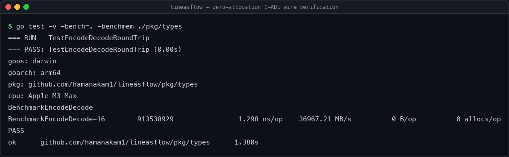

# LineasFlows Edge-Mesh Daemon

[](https://github.com/hamanakam1/lineasflow/actions/workflows/ci.yml)
[](https://github.com/hamanakam1/lineasflow/actions/workflows/release.yml)
[](LICENSE)
[](go.mod)
[](https://github.com/hamanakam1/lineasflow/releases)

LineasFlows is a high-performance edge-mesh synchronizer daemon (the "Ticket Dispenser") for the Bumperfort Fortran physics coprocessor. It reads calculated high-dimensional state outputs from Bumperfort via POSIX shared memory (zero-copy) and synchronizes states across a local mesh of Apple Silicon (M3 Max) and Raspberry Pi 5 nodes.



## Architecture
- `cmd/lineasflowd/` daemon entrypoint
- `internal/shm/` cgo POSIX shared memory bridge (lock-free dirty bit reader)
- `internal/mesh/` raw UDP multicast broadcaster (no JSON/protobuf; raw binary)
- `pkg/types/` C-ABI mirrored structs

## Build
```
make build-mac
make build-pi
```

## Constraints
- No serialization overhead: raw binary payload only.
- Zero-allocation hot path for shared memory polling.
